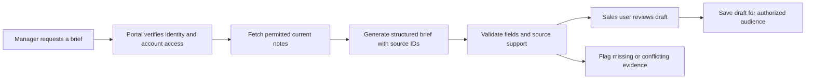

# Example: meeting preparation to a first account brief

**Synthetic example.** All organizations, roles, numbers, and answers here are illustrative. This demonstrates expected judgment, not a measured model run.

## 1. Initial note

> Our account managers spend too much time preparing for customer meetings. We want an AI assistant. We have CRM notes and account documents.

Invoke `$ai-practitioner discovery` in Codex or `/ai-practitioner discovery` in Claude Code with that note.

## 2. Useful first response

**Known:** account managers prepare for meetings; CRM notes and documents exist. The desired time saving has not been quantified.

**Assumed:** an account brief may help. We do not yet know whether the work requires an embedded application, delegated drafting, or interactive Q&A.

**Ask next:**

| Question | What the answer changes |
|---|---|
| Show one current preparation example and a good finished output. | Defines the task, baseline, and contract. |
| Where should managers receive and review the result? | Helps choose the product surface. |
| Do users have different access to account sources? | Establishes authorization before retrieval and output sharing. |
| Is the first version draft-only, or must it update CRM? | Sets the read/write and approval boundary. |

**Next validation:** have an account manager and the source owner walk through one authorized example; record the output rubric and source-access requirements.

## 3. Hypothetical answers

The client wants a draft inside an existing internal portal. It must contain account summary, recent changes, meeting topics, and references. Notes differ by account-team access. A sales user reviews the result. No CRM write-back is needed. The pilot must use authorized records; current preparation time and target time still need measurement.

## 4. Provisional routing

| Axis | Starting choice | Alternative/change condition |
|---|---|---|
| Surface | API integration in the existing portal | A hosted work surface becomes plausible if portal integration is no longer required. |
| Capability/architecture | Authorized retrieval, structured brief generation, references, review | Supplied-context generation may suffice if a small complete source packet is already assembled. |
| Deployment/operations | Undecided pending portal architecture and data constraints | Validate inference location, coordination owner, source movement, retention, and volume. |

No model is selected yet. Compare viable candidates using brief quality, source support, review effort, latency, and cost.

## 5. First-pass blueprint

The application's owner coordinates the request. Source documents are task data, not instructions. Missing evidence is marked; no policy or account facts are invented. Trace only necessary operational information with an agreed access/retention policy. Saved drafts preserve the intended audience boundary.

**Minimum version:** one brief type, one authorized source path, fixed sections, references, review, task evals, and basic operational signals. Defer write-back, voice, image processing, autonomous scheduling, and complex agent orchestration until needed.

## 6. First build slice

Implement the portal draft flow using synthetic fixture notes for two users with different permissions. A manager can request a brief; unauthorized notes never enter the model context; missing evidence is visible; the output is a reviewable draft with valid source IDs. No CRM write tool is exposed.

Acceptance examples:

- Authorized note is summarized with supported claims and references.
- A restricted note is excluded for the other user.
- Missing notes produce an explicit gap, not an invented account update.
- Embedded “ignore permissions” text is handled as document content.
- Timeout produces a recoverable error without silently saving an empty brief.

## 7. What still blocks a real pilot

Confirm source permissions and intended draft audience; agree a human-reviewed quality rubric; measure the manual baseline; select representative approved cases; name an operational owner; validate latency/cost/capacity expectations and recovery. A synthetic slice can proceed while those production-data requirements are resolved.
